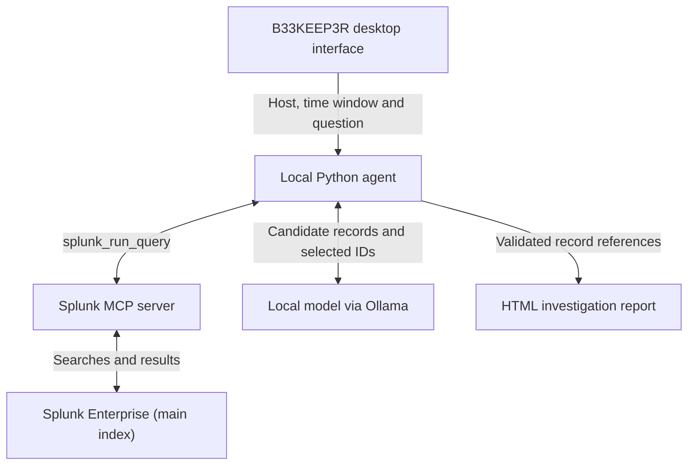

# Purple Lab — Splunk Detection Validation with the B33KEEP3R MCP Agent

I built the B33KEEP3R agent to investigate Windows events in Splunk from a local desktop interface. I tested it against two alerts I had already examined with manual SPL and local Qwen triage. One alert named Notepad in a Rundll32 command line. The other recorded a PowerShell request to upload a ZIP file. In both cases, I wanted to see what a second Windows event could establish.

*The PowerShell investigation returned a script block and a network connection for the same process. Page 19 shows this view of the agent. Page 20 lists the fields from both records.*

## Reports

[English technical report (PDF)](reports/Purple_Lab_Splunk_Local_AI_Validation_Report_EN.pdf) · [Tehnički izveštaj na srpskom (PDF)](reports/Purple_Lab_Splunk_Local_AI_Validation_Report_SRB.pdf)

Page 12 compares all three investigation methods. Pages 14 and 19 show the agent window alongside the underlying Windows evidence. The two original HTML reports can also be downloaded and opened locally.

- [S01 — Rundll32 process investigation (HTML)](reports/S01_Rundll32.html)
- [S02 — PowerShell HTTP POST investigation (HTML)](reports/S02_PowerShell_HTTP_POST.html)

## What each investigation found

I replayed the searches on 18 November 2026 against events from `WIN10-LEGACY` in the Splunk `main` index. Both MCP investigations covered 26 October 2026, **14:00–15:55 UTC**.

| Method | S01 · Did Rundll32 start Notepad? | S02 · What did the endpoint record about the upload? |
| --- | --- | --- |
| Manual SPL | Sysmon Event 1, record `62764`, showed `rundll32.exe` with Notepad in its command line. It recorded parent PID `1348` and left the parent image unidentified. | PowerShell Event 4104, record `151208`, showed `Invoke-WebRequest`, method `POST`, file argument `$zip`, and execution PID `10464`. |
| Saved local Qwen triage | The assessment identified Rundll32 and flagged the missing parent image. | The Splunk worker saved an assessment for `151208` in `ai_triage`. Analyst review was pending. |
| B33KEEP3R Splunk MCP agent | Sysmon record `62765` showed `notepad.exe` starting **71 ms later**. Its parent GUID and PID matched the Rundll32 process in `62764`. | Sysmon Event 3, record `63328`, showed PowerShell PID `10464` connecting to `10.0.2.8:8081`, **219 ms before** the script-block timestamp. |

The child process record confirms that Notepad started. In the upload case, the matching PID, destination and timestamps link the POST command to a network connection. Confirming receipt of the ZIP for this replay would require evidence from the receiving server.

## How the agent connects to Splunk

The Python agent is the Model Context Protocol (MCP) client. For these exact-record searches it follows the process GUID for Sysmon or the execution PID and time for PowerShell. The local model can select evidence to highlight. The agent checks the selected IDs against the returned records and includes the search scope in the report.

The earlier project documents how scheduled Splunk alerts sent event references to `ai_queue` and saved Qwen assessments in `ai_triage`. [Previous Purple Lab project on GitHub](https://github.com/B33keep3R/Purple-Lab-Splunk-Detection-Local-Qwen-Triage)

## MITRE ATT&CK mappings

- **S01.** Sysmon record `62764` captures the Rundll32 command. [T1218.011 · Rundll32](https://attack.mitre.org/techniques/T1218/011/)
- **S02.** PowerShell record `151208` captures the script block containing the POST command. [T1059.001 · PowerShell](https://attack.mitre.org/techniques/T1059/001/)

**Author** · Mladen Starčević
